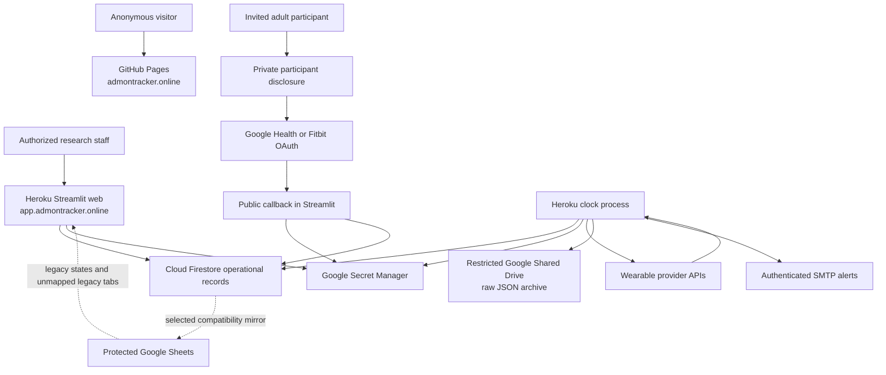

# AdmonTracker project memory

## Current local CASA work — 8 October 2026

The audited production snapshot below is preserved as history. New **undeployed**
work is on `casa-readiness`, based on `heroku` `f96a9836` / reported Heroku v76.
See [the CASA review package](casa/README.md) before implementing, merging or
deploying anything. The original CASA prompt remains unchanged.

The P0 local corrections remove prefix authorization, verify numeric enabled/
disabled secret destruction, and commit collection blocks before credential or
provider access. Supporting local work adds enrollment/code/session fences,
transactional OAuth claims, pinned token versions, fallback authenticator MFA,
scoped registry writes, enrollment-specific archive identity and safer email/errors.
No production/cloud/key/data changes or Git push were performed.

On this branch, staff authorization is **not** a scalar prefix assignment:
explicit approved Google issuer/subject bindings plus validated claims and a
server-side MFA-backed session are required. Student production access is denied;
Admin cross-project access requires an explicit `*` assignment. Preserve old
private configuration for compatibility but do not reactivate prefix grants.
Old management bearer links are retired in favor of one-use enrollment-bound
codes. Reconnects must preserve original consent dates.

The full release is **not assessor-test ready**. Legacy canonical-gate backport,
reviewed staff/enrollment migration, live Google MFA feasibility, exact runtime/SDK
and browser integration, scheduled deadline delivery, audited deletion checklist,
all-copy ownership and effective platform/IAM evidence remain gates. Stopping,
remote revocation and verified data deletion are different states. Routine
collection stopping and research-data deletion remain manual.

A redacted narrow scan found credential-like patterns in older Git snapshots and
the legacy line. It does not establish current credential validity; review/rotation
needs explicit approval. Do not repeat a claim that Git history contains no secrets.
No credentials are included in this memory. See [findings](casa/FINDINGS.md).

Everything below describes the prior audit unless explicitly reconciled with this
overlay. In particular, its Student/prefix/management-link descriptions are not
the intended CASA branch controls and must not be copied into new security claims.

This document is the durable technical and operational memory for the AdmonTracker
repository. It is written so that a new developer or LLM can understand the system,
its history, the decisions behind it, the production topology, the remaining work,
and the constraints that must not be accidentally removed.

## Document status

| Field | Value |
| --- | --- |
| Repository audit date | 8 October 2026, Asia/Jerusalem |
| Audited branch | `heroku` |
| Audited commit | `f96a9836320bc120ba4ba49887a6da33d050c3f0` — Make wearable OAuth Firestore authoritative |
| Worktree during audit | Clean before this document was added |
| Test result | 152 passed, 6 non-failing pytest warnings |
| Production reachability | Root public site and Heroku app returned HTTP 200 on 8 October 2026 |
| Canonical application | `https://app.admontracker.online/` |
| Canonical public site | `https://admontracker.online/` |
| Institution | Stress & Psychopathology Lab, School of Psychological Sciences, University of Haifa |
| Study | 385/23 |
| Principal investigator | Prof. Roee Admon, `radmon@psy.haifa.ac.il` |

Statements marked **repository-verified** were checked against this commit. Statements
marked **operator-reported** come from the project work history and must be reconfirmed
in the relevant external console if a release depends on them. Statements marked
**external check required** cannot be proven from Git.

## One-page context for a new LLM

AdmonTracker is a bilingual Streamlit research-operations application for University
of Haifa Study 385/23. Authorized staff use it to register pseudonymous wearable
records, obtain participant authorization, view Fitbit or Google Health signals,
inspect device status, configure alerts, and monitor collection completeness. It is
not a clinical or emergency-monitoring system.

The current production line is the `heroku` branch. The older `main` branch supports
the original Streamlit Community Cloud/Google Sheets deployment and must not be
silently converted to the Heroku configuration. The two deployments currently have
different compatibility needs and have used different Google Cloud projects.

The production topology is:

- GitHub Pages on `admontracker.online` for the signed-out, crawlable homepage,
  privacy policy, terms, research-ethics page, logo, and downloadable approvals and
  consent documents.
- Heroku on `app.admontracker.online` for the Streamlit web process and one dedicated
  clock process.
- Google Cloud Firestore as the authoritative operational store on the Heroku path.
- Google Secret Manager for participant OAuth tokens, provider client secrets, and
  the Streamlit runtime-secret bundle.
- A restricted Google Shared Drive for raw wearable JSON archives.
- Google Sheets as a protected legacy/recovery system and a deliberately narrow
  compatibility bridge for the older Streamlit deployment. It is not the primary
  database for modern Heroku OAuth flows.

The production Google Health client requests exactly four read-only scopes: activity
and fitness, health metrics and measurements, sleep, and settings. The settings scope
is needed for watch model, battery level/status, and last synchronization time. The
app does not request Google Health write access or mindfulness access.

The ethics-approved bilingual Google Health addendum is version
`385-23-GOOGLE-HEALTH-v1.0`. The approved data categories are heart rate, steps,
sleep, physical activity, respiratory rate, and the assigned watch's model, battery
status/level, and last synchronization time. Google Health collection is described as
one month, followed by up to one additional month for processing and quality checks.
Withdrawal stops collection and calls for deletion unless separate explicit retention
consent is obtained. The app records disconnection and deletion requests; completion
of deletion across all storage locations remains an operational research-team task.

Google branding verification is **operator-reported complete**. The repository and
public site are prepared for the data-access review and reviewer video, but final
Google publication/verification approval is **not proven by this repository**. Do not
claim that the OAuth app is fully published until the Google Auth Platform shows the
approved production status.

## Product scope

### Intended users

- **Anonymous visitors** can view the public purpose, privacy, terms, and research
  ethics material without login.
- **Participants** receive a private, expiring, single-use authorization link. They
  do not need staff access to complete the disclosure and provider OAuth flow.
- **Guest users** can enter a synthetic, read-only demonstration that is isolated
  from production data and external APIs.
- **Students** can use authorized dashboard views for their assigned scope.
- **Managers** can use operational dashboards, manage devices in their project,
  configure alerts, and generate participant authorization links.
- **Admins** have cross-project management and can add production Google Health OAuth
  client metadata through the protected staff UI.

Staff roles and project assignments are authoritative in the rendered Streamlit
secrets, using a scalar assignment such as `Manager, ProjectName`. Do not move staff
authorization into the redundant historical `project` worksheet without an explicit
access-control redesign.

### Active application pages

| Route/file | Audience | Purpose |
| --- | --- | --- |
| `app.py` | Public, guest, staff | Callback entry point, authentication, public purpose, four-scope summary, and staff landing page |
| `pages/01_Home.py` | Admin/Manager or guest demo | Operational project and device overview |
| `pages/02_Dashboard.py` | Authorized staff or guest demo | Provider-aware signal charts, missing-data checks, and device details |
| `pages/03_Fitbit_Management.py` | Admin/Manager or guest demo | Device registry, activation date, active state, project assignment, and alert mute control |
| `pages/04_Alerts_Configuration.py` | Admin/Manager or guest demo | Wearable alert thresholds and recipients |
| `pages/07_OAuth_Connect.py` | Admin/Manager or guest demo | Register a watch, select provider/client, attest consent/adult status, and generate a private link |
| `pages/08_Privacy_Policy.py` | Public | Bilingual in-app privacy policy |
| `pages/09_Terms_of_Service.py` | Public | Bilingual in-app terms |
| `pages/10_Research_Ethics.py` | Public | Preview and download ethics and participant documents |
| `pages/11_Participant_Authorization.py` | Participant with private state | Bilingual disclosure, document download, affirmative acknowledgement, and handoff to provider OAuth |
| `pages/12_Manage_Connection.py` | Participant with private management token | Disconnect and record a deletion request |

The old Qualtrics, AppSheet, and generic participant-connect pages were removed from
production navigation and from the `heroku` branch's pages directory. Some legacy
Qualtrics/WhatsApp code remains in `run_data_collection.py` for backward compatibility
and is isolated so its failure does not prevent wearable alerts.

## Architecture



### Runtime processes

The `Procfile` defines two processes:

```text
web: render Streamlit secrets, then run app.py on Heroku's PORT
clock: render Streamlit secrets, then run clock.py
```

The web process handles Streamlit pages and OAuth callbacks. The clock process uses
APScheduler in `Asia/Jerusalem`:

- minute `00`: wearable status collection and alert evaluation;
- minute `30`: Shared Drive archive collection;
- every five minutes: clock heartbeat;
- startup: one bounded catch-up of the idempotent jobs when enabled;
- concurrency: one in-process non-blocking job lock, `max_instances=1`, coalescing,
  and a 30-minute misfire grace period;
- retry delays: configurable, with safe bounded defaults.

The production design requires exactly one clock dyno. Heroku Scheduler is not the
authoritative hourly scheduler.

## End-to-end identity and authorization flows

### 1. Staff authentication

1. Staff open `app.admontracker.online` and use Streamlit's Google login.
2. The staff OAuth client requests only `openid`, `profile`, and `email`.
3. Streamlit validates the login and exposes the email claim.
4. `utils/access_control.py` finds the email-prefix assignment in Streamlit secrets.
5. The assignment resolves to Admin, Manager, Student, or Guest plus a project.
6. A change in identity or mode clears data-bearing Streamlit session state.
7. Page-level checks enforce real-data, write, device-management, and external-service
   capabilities.

Do not add participant health scopes to the staff client. Staff identity and
participant wearable access are intentionally separate OAuth concerns.

### 2. Staff creates a participant link

1. An Admin or Manager opens **Connect Account to a Watch**.
2. Staff chooses a pseudonymous watch code, project, provider, and—when applicable—the
   active Google Health OAuth client key.
3. Staff attests that the approved consent was completed and the participant is at
   least 18 years old.
4. The device row is inserted or intentionally replaced.
5. A random OAuth state is stored with provider, watch, project, purpose, creator,
   staff attestation timestamps, and a 48-hour expiry.
6. When participant disclosure is enforced, the generated link points first to
   `/Participant_Authorization`, not directly to Google or Fitbit.

The private state must not be printed in screenshots, logs, tickets, or a reviewer
video. The UI hides it behind a collapsed copy control and offers a direct open button.

### 3. Participant disclosure and provider OAuth

1. The participant opens the private link and chooses English or Hebrew.
2. The app validates that the state exists, has not expired, and has not been used.
3. The participant can save the disclosure and download the approved documents.
4. Google Health participants affirm six disclosure items; Fitbit participants affirm
   the applicable shorter set.
5. The app appends a pseudonymous consent audit record containing the watch/project
   codes, provider, language, disclosure version/hash, staff-attestation time, and
   participant-acknowledgement time. It stores no participant name or IP address in
   that consent record.
6. Only after acknowledgement does the app create the provider authorization button.
7. The callback revalidates the state and current disclosure version, records replay
   protection, and consumes the state before exchanging the code.
8. Provider error bodies are not shown or logged because they may echo codes, tokens,
   credentials, or health details.

### 4. Token storage and refresh

- Participant access and refresh tokens are stored as JSON payloads in Secret Manager.
- Firestore stores the Secret Manager resource reference, scope, expiry, status, and
  audit metadata, not plaintext tokens.
- Token refresh adds a new secret version and updates operational metadata.
- Google Health client secrets are also stored in Secret Manager; the OAuth-client
  record keeps a reference and non-secret configuration.
- The Heroku service-account credential is a single base64 bootstrap config variable
  loaded into memory. It is not committed and should not be duplicated throughout the
  Streamlit bundle.
- `ALLOW_PLAINTEXT_SECRET_FALLBACK=false` is the production target and is
  operator-reported as configured on Heroku.

Fitbit still has compatibility logic for older static or append-only tokens. On the
production branch, a fresh Fitbit authorization can replace an old plaintext row
without reading or reviving the old plaintext value. The old `main` deployment has a
separate compatibility configuration; do not assume its service account can access
the production Secret Manager project.

### 5. Successful connection, management, and deletion request

After token storage, the callback creates a random management token with a default
365-day validity. Only its SHA-256 hash is persisted. The success page shows a
**Manage this connection** button; it does not print the token-bearing URL.

On the management page, the participant can:

- disconnect, which stops future collection, attempts remote provider revocation,
  deactivates the local token metadata, destroys enabled Secret Manager versions, and
  marks the device connection disconnected; and
- record a deletion request containing the approved policy text and an open status.

Recording a request is not the same as proving complete erasure. The research team
must process it across Secret Manager, Firestore/recovery records, the Shared Drive,
and any approved University identity-link system according to the approved procedure.

## Provider integrations

### Google Health

The production client must use exactly these scopes:

| Scope | Implemented use |
| --- | --- |
| `googlehealth.activity_and_fitness.readonly` | Steps and physical activity |
| `googlehealth.health_metrics_and_measurements.readonly` | Heart rate and respiratory rate |
| `googlehealth.sleep.readonly` | Sleep sessions, timing, duration, and stages when available |
| `googlehealth.settings.readonly` | Assigned watch model, device type when returned, battery level/status, and last sync time |

Production client validation fails if the redirect or the scope set differs from the
required values. Mindfulness and all write scopes are intentionally excluded.

Google Health API responses are normalized into the Fitbit-shaped structures already
used by the dashboard, which allows most UI and monitoring logic to stay
provider-neutral.

### Fitbit legacy

Fitbit OAuth requests `activity`, `heartrate`, `sleep`, and `respiratory_rate`.
The app supports authorization-code exchange, refresh, revocation, legacy token
resolution, dashboard queries, status monitoring, and raw archive generation.

This integration is transitional. The team has tracked a provider deadline for the
legacy Fitbit Web API around 30 October 2026. Treat that date as a time-critical
operator note and verify the current official Fitbit/Google migration announcement
before making a release decision. New development should favor Google Health unless
the approved study documents and provider status require otherwise.

## Dashboard and device behavior

The dashboard selects the provider from the device registry and constructs the
corresponding client. It currently offers:

- heart-rate intraday data;
- steps intraday data;
- sleep duration and timing;
- physical-activity sessions;
- respiratory rate;
- missing heart-rate coverage; and
- device details and the latest status snapshot.

For Google Health, heart rate and steps use rollups, sleep and exercise use bounded
list filters, respiratory rate uses the daily-respiratory-rate resource, and paired
devices supply model, battery, and last-sync information. For Fitbit, the equivalent
Fitbit Web API endpoints are used.

Intraday Fitbit requests that cross midnight are split/dated correctly so the API is
not sent a future time on the prior date. Date inputs are clamped against future
dates. Polars conversions normalize mixed native dates and ISO strings to prevent the
device-management schema error seen during the migration.

The device-management table intentionally starts with:

1. watch name;
2. project;
3. last activated date;
4. Active; and
5. Mute Alerts.

Managers are restricted to their project. Admins can manage all device rows and OAuth
client selection.

## Monitoring and email alerts

Hourly collection creates the latest operational watch status and evaluates each
active, unmuted device against the configured synchronization, heart-rate, sleep,
steps, and battery thresholds.

For one continuous problem episode, the delivery schedule is:

```text
detection -> immediate email -> 1h -> 2h -> 4h -> 8h -> 16h -> 24h -> every 24h
```

Intervals are measured from the previous successful email. State is persistent, so a
dyno restart does not restart the sequence. Resolution, deactivation, or muting closes
and resets the episode; a later recurrence starts immediately and opens a new thread.

Messages use stable `Message-ID`, `In-Reply-To`, and `References` headers so supported
mail clients group reminders into a conversation. Alert state stores only a one-way
recipient fingerprint, not recipient addresses. Each message distinguishes the alert
generation time from the device's last checked and last synchronized times and may
include the latest battery and heart-rate values already present in operational
status. It does not perform extra provider calls merely to draw an email chart.

SMTP configuration comes from `SENDER_EMAIL_ADDRESS`, `SENDER_EMAIL_PASSWORD`,
`SMTP_SERVER`, and `SMTP_PORT`. Never commit or print the sender password. The legacy
Qualtrics/WhatsApp alert path runs after the production wearable-alert path and cannot
block it.

## Data storage model

### Firestore: authoritative operational records

The migration layer preserves historical Sheet names as logical source names but maps
them to explicit Firestore collections with deterministic, hashed document IDs.
Direct identifiers do not appear in document paths. The core mappings are:

| Logical source | Firestore collection | Purpose |
| --- | --- | --- |
| `user` | `users` | Participant/device assignment fields only: name, email, project |
| `fitbit` | `devices` | Device registry and provider/auth status |
| `fitbit_alerts_config` | `alert_configurations` | Alert thresholds and routing |
| `fitbit_alert_state` | `fitbit_alert_state` | Persistent escalation/thread state |
| `health_oauth_clients` | `oauth_clients` | Active provider client metadata and secret reference |
| `health_oauth_tokens` | `health_oauth_tokens` | Latest active Google Health token metadata/reference |
| `fitbit_oauth_tokens` | `fitbit_oauth_tokens` | Latest connected Fitbit token metadata/reference |
| `health_oauth_states` | `oauth_states` | Modern consent-aware OAuth states |
| `health_oauth_state_used` | `oauth_state_usage` | Modern replay records |
| `oauth_states` | `fitbit_oauth_states` | Legacy Fitbit states from the old app |
| `oauth_state_used` | `fitbit_oauth_state_usage` | Legacy Fitbit replay records |
| `health_oauth_consents` | `oauth_consents` | Append-only pseudonymous disclosure audit |
| `health_reauth_queue` | `reauth_queue` | Reauthorization work |
| `health_connection_management` | `connection_management` | Hashed participant management tokens |
| `health_deletion_requests` | `deletion_requests` | Participant deletion requests |
| `archive_manifest` | `archive_manifest` | Logical archive periods, hashes, file IDs, status |
| `job_runs` | `job_runs` | Audited scheduler runs |
| `clock_status` | `clock_status` | Clock heartbeat/release status |
| `watch_status_history` | `watch_status` | Latest watch-status history mapping |
| `FitbitLog` | `device_status` | Latest device status per project/watch |
| `log` | `collection_status` | Latest collection status per project/watch |

`health_api_logs` is mapped to `health_api_logs` only in the optional history profile.
High-volume history is not part of the default core migration. Plaintext token,
client-secret, credential JSON, and cookie-secret fields are always removed by the
migration sanitizer.

### What did not migrate from Sheets

The Firestore migration is deliberately not a full workbook clone:

- staff roles and project access remain in Streamlit secrets;
- the separate `project` tab is redundant because each device carries its project;
- `student_fitbit` is not required for the new operational model;
- Qualtrics, AppSheet, Bulldog, and unrelated research tabs remain outside the
  Firestore cutover; and
- large historical status/API tables remain in the frozen Sheet or raw archive unless
  an explicit retention and migration decision is made.

### Sheets compatibility behavior

When `DATA_BACKEND=firestore`, modern device and OAuth misses are authoritative empty
results and do not silently fall back to Sheets. The only explicit read fallback kept
for OAuth is for the two old Fitbit state tables, allowing the Heroku callback to
finish an old Streamlit-generated link during the transition.

When `SHEETS_SHADOW_WRITE=true`, reverse mirroring is restricted to the low-volume
`fitbit`, `fitbit_oauth_tokens`, and `health_oauth_tokens` records so the old app can
see registry updates and token references. Consent states, API logs, status logs,
alerts, and other high-volume records are not mirrored. Unmapped legacy tabs still
use Sheets by design.

This narrow bridge is the correction for the earlier Google Sheets quota problem.
Do not re-enable collection-wide Sheets reads or broad shadow writes.

### Secret Manager

Secret Manager contains:

- one Streamlit runtime bundle secret referenced by
  `STREAMLIT_SECRETS_SECRET_REF`;
- provider OAuth client secrets; and
- one logical participant/provider token secret whose versions rotate during refresh.

The runtime service account needs only the permissions required to create/get secrets
when applicable and add, access, list, and destroy secret versions. A local credential
file being present is not sufficient: the service account encoded in the active
Heroku bootstrap variable must have access in the same project named by the secret
resource. A reference such as `projects/<project-id>/secrets/<secret-id>` must contain
the real project ID, not a project display name or malformed value.

### Shared Drive raw archive

New archive writes use direct deterministic JSON files. Historical ZIP support remains
in helper code for readability of earlier archives, but new collection does not write
ZIP packages.

```text
AdmonTracker Raw Archive/
  <project>/
    <watchName>/
      FITBIT/                  # or GOOGLE_HEALTH
        Physical Activity/
        Sleep/
        Stress/                # intentionally created and normally empty
```

Provider/data cadence:

| Provider | Daily | Monthly |
| --- | --- | --- |
| Fitbit | heart rate, HRV, calories | steps, sleep, skin temperature, respiratory rate |
| Google Health | heart rate | steps, sleep, respiratory rate |

Google Health archive categories are intentionally limited to the approved addendum;
it does not archive calories, HRV, or skin temperature. Filenames are deterministic
by data type and bounded period. `archive_manifest` stores a logical key, checksum,
Drive file ID/link, byte size, and status. An unchanged checksum prevents duplicate
uploads; a changed retry updates the same file.

Drive calls use Shared Drive-compatible options including `supportsAllDrives` and
`includeItemsFromAllDrives`. Folder path segments are sanitized. New collection begins
at `ARCHIVE_CUTOVER_AT`; the historic lab-mounted archive is left read-only and is not
migrated.

## Compliance and public publication package

### Public URLs

| Purpose | URL |
| --- | --- |
| Public homepage | `https://admontracker.online/` |
| Privacy policy | `https://admontracker.online/privacy.html` |
| Terms | `https://admontracker.online/terms.html` |
| Research ethics | `https://admontracker.online/research-ethics.html` |
| Staff application | `https://app.admontracker.online/` |

The root domain is a plain static GitHub Pages site so Google reviewers and crawlers
can understand the app without JavaScript, authentication, or Streamlit routing. A
GitHub Actions workflow assembles the site, logo, and compliance PDFs. The `app`
subdomain remains on Heroku. HTTPS and domain ownership/branding verification are
operator-reported complete.

### Canonical evidence assets

| Asset | Meaning |
| --- | --- |
| `assets/compliance/ethics-approval-385-23-en.pdf` | Study-specific ethics approval |
| `assets/compliance/institutional-ethics-governance-he.pdf` | University ethics governance evidence in Hebrew |
| `assets/compliance/pilot-consent-baseline-he.pdf` | Hebrew participant informed-consent form |
| `assets/compliance/google-health-addendum-385-23-en-approved-v1.0.pdf` | Approved English Google Health addendum |
| `assets/compliance/google-health-addendum-385-23-he-approved-v1.0.pdf` | Approved Hebrew Google Health addendum |

The approved addendum PDF hashes are recorded in
`docs/compliance/google_health_addendum_approved.md`. The Streamlit ethics page uses
`st.pdf` preview when supported and provides download buttons. The public Pages
workflow publishes the same stable assets.

### Approved retention/deletion meaning

- collection: one month after connection activation, ending earlier on disconnect or
  withdrawal;
- processing/quality retention: up to one additional month;
- routine deletion: Google Health measurement data and the identity link are to be
  permanently deleted no later than one month after measurement ends;
- withdrawal: collection and authorization stop immediately, and collected data are
  deleted unless the participant gives separate explicit retention consent at that
  time;
- signed consent and non-measurement administrative records follow University and
  research requirements;
- already-published aggregate results cannot be removed from an existing publication.

The wording in the approved bilingual participant PDFs is the canonical source. Code
or documentation changes must not paraphrase it into a materially different promise.

### Google publication stage

Repository-verified:

- public signed-out homepage, privacy, terms, and ethics implementation;
- exact four-scope Google Health configuration and production redirect validation;
- approved bilingual addenda and participant disclosure gate;
- separate staff and participant OAuth concepts;
- Secret Manager token/client-secret storage;
- Firestore operational routing and bounded Sheets compatibility;
- reviewer-video script and scope-by-scope demonstration plan;
- tests for public pages, consent gates, secret redaction, Firestore migration,
  archive behavior, and provider dashboards.

Operator-reported:

- Search Console/domain ownership completed;
- DNS and HTTPS enabled;
- Google branding verification completed;
- the production site was deployed to GitHub and Heroku;
- the production Heroku branch was manually pushed after the latest fixes;
- Secret Manager, Firestore, Shared Drive, and the Google Health scopes were
  configured during rollout.

External check required before claiming publication complete:

- Google Auth Platform shows the correct canonical project and External audience;
- separate production web clients are selected for staff login and participant health;
- exact redirects are registered:
  - `https://app.admontracker.online/oauth2callback`
  - `https://app.admontracker.online/?google_health_callback=1`
  - `https://app.admontracker.online/?fitbit_callback=1` in the Fitbit console;
- the data-access request contains the same four scopes and no mindfulness scope;
- Google Health research intake/attestation is submitted and accepted;
- the final reviewer video is recorded with the production client, uploaded, and
  accepted;
- Google has moved the OAuth app to the intended published/verified production state;
- any security assessment requested by Google is complete;
- Shared Drive access was manually reconciled against the authorized study team;
- every legacy plaintext OAuth value was audited and removed where required; and
- the ethics committee's actual registry/accreditation identifier or an official
  English institutional confirmation is available if Google asks for it. The uploaded
  governance document refers to registration but does not itself establish the actual
  identifier.

The operational checklist is `docs/compliance/google_publication_checklist.md`; the
word-for-word demonstration is
`docs/compliance/google_reviewer_video_and_submission.md`.

## Configuration contract

Never include config values in documentation, logs, commits, or LLM prompts. The
following names describe the contract only.

### Required production identity and bootstrap settings

- `APP_BASE_URL`
- `GOOGLE_SERVICE_ACCOUNT_JSON_B64`
- `GOOGLE_CLOUD_PROJECT`
- `STREAMLIT_SECRETS_SECRET_REF` (preferred) or the legacy
  `STREAMLIT_SECRETS_TOML_B64`
- Streamlit `[auth]` and `[auth.google]` entries inside the protected runtime bundle
- `SPREADSHEET_KEY` or the protected `spreadsheet_key` for legacy/unmapped access

### Data backend and migration settings

- `DATA_BACKEND`
- `FIRESTORE_PROJECT_ID`
- `FIRESTORE_DATABASE_ID`
- `FIRESTORE_SHADOW_WRITE`
- `SHEETS_READ_FALLBACK`
- `SHEETS_SHADOW_WRITE`
- `SECRET_MANAGER_ENABLED`
- `ALLOW_PLAINTEXT_SECRET_FALLBACK`

The intended Heroku end state is Firestore primary, Firestore shadow write off,
plaintext fallback off, and only the narrowly allowed Sheets recovery bridge active.
Check the actual Heroku values after every configuration change; do not infer them
from the defaults in `scripts/prepare_heroku_config.py`, because that script begins a
new deployment in conservative staged-migration mode.

### Disclosure settings

- `PARTICIPANT_DISCLOSURE_ENFORCED`
- `PARTICIPANT_DISCLOSURE_VERSION`
- `RESEARCH_RETENTION_TEXT_EN`
- `RESEARCH_RETENTION_TEXT_HE`
- `RESEARCH_DELETION_TEXT_EN`
- `RESEARCH_DELETION_TEXT_HE`
- optional approved-addendum path overrides

Production Google Health authorization is unavailable when the disclosure gate is
off. Enforcement also fails closed if the version is a draft, the approved PDFs are
missing, or the bilingual retention/deletion wording is empty.

### Provider settings

- Fitbit: `FITBIT_CLIENT_ID`, `FITBIT_CLIENT_SECRET` or
  `FITBIT_CLIENT_SECRET_REF`, `FITBIT_REDIRECT_URI`, and `FITBIT_SCOPES`.
- Google Health client metadata is stored through the `health_oauth_clients` logical
  record and Secret Manager rather than a single global plaintext client value.

### Clock, archive, and alerts

- `SCHEDULER_TIMEZONE`
- `CLOCK_RUN_JOBS`
- `CLOCK_CATCH_UP_ON_START`
- `CLOCK_RETRY_DELAYS_SECONDS`
- `ARCHIVE_RUN_JOBS`
- `ARCHIVE_SHADOW_MODE`
- `ARCHIVE_CUTOVER_AT`
- `ARCHIVE_ENABLED_PROVIDERS`
- `ARCHIVE_ITEM_RETRY_DELAYS_SECONDS`
- `GOOGLE_DRIVE_ARCHIVE_ROOT_ID`
- `GOOGLE_DRIVE_ARCHIVE_SUBFOLDER`
- `SENDER_EMAIL_ADDRESS`
- `SENDER_EMAIL_PASSWORD`
- `SMTP_SERVER`
- `SMTP_PORT`

## Deployment and migration runbook

### Safe preparation

1. Confirm the current branch and dirty state with `git status --short` and
   `git branch -vv`.
2. Preserve unrelated user changes.
3. Keep all local credential, generated `.heroku`, `.env`, and Streamlit secrets files
   ignored.
4. Generate the deployment bundle with `scripts/prepare_heroku_config.py` using the
   private Streamlit source, staff OAuth JSON, service-account JSON, production base
   URL, runtime-secret reference, and Drive root ID.
5. Upload the ignored runtime payload with `scripts/upload_runtime_secrets.py` and
   verify its readback.
6. Apply config variables through the Heroku dashboard or authenticated Heroku CLI
   without printing values.
7. Deploy the `heroku` branch and scale exactly one web process and one clock process
   only when jobs are ready.

The startup renderer checks that Streamlit's staff-login redirect host matches
`APP_BASE_URL`. If they differ, the dyno intentionally exits instead of starting with
an inconsistent OAuth configuration.

### OAuth secret migration

The migration command supports dry run, apply, verified readback, and a final
plaintext-clearing phase. It groups append-only token history so only the current
active participant/provider token is materialized as a Secret Manager secret. The
previous recovery rows remain available for audit until explicitly cleared.

Do not clear plaintext until the same deployed service account can create/add/access
the target secret and live authorization plus refresh tests pass. A 403 on
`secretmanager.versions.access` means the runtime principal or target project IAM is
wrong; it is not fixed by changing application fallback logic.

### Firestore migration

The safe sequence is:

1. dry-run `scripts/migrate_sheets_to_firestore.py` with the core profile;
2. apply and verify deterministic documents;
3. run `scripts/verify_firestore_migration.py`;
4. run `scripts/smoke_firestore_backend.py` with Sheets fallback forced off;
5. observe a shadow period if still needed;
6. set Firestore authoritative;
7. retain only the narrow old-app compatibility writes; and
8. monitor Firestore reads and Sheets quotas.

Do not run the `all` history profile without reviewing Firestore write/read cost and
the approved retention decision. The earlier implementation streamed whole Firestore
collections for point lookups and caused extreme read volume. The current store uses
deterministic point reads for complete identities and indexed equality queries for
partial filters. Preserve that behavior.

### Archive cutover

1. Record an approved RFC3339 `ARCHIVE_CUTOVER_AT` in Asia/Jerusalem.
2. Start in shadow mode and validate manifest rows without Drive writes.
3. Enable only approved providers.
4. Compare outputs with the old lab process.
5. Disable the old lab cron before making the Heroku clock authoritative.
6. Disable shadow mode and confirm deterministic Drive files, hashes, heartbeats, and
   audited job runs.
7. Do not migrate the historic mounted-drive archive.

## Repository history

The repository contains 573 commits across all refs at this audit. The `heroku` branch
contains 571 reachable commits and `main` contains 540; merge commits are included.
Their common production fork point is commit `5085ee9` from 14 September 2026.

Key production-line milestones, in order:

| Date | Commit | Milestone |
| --- | --- | --- |
| 31 Mar 2025 | `e08c70b` | Initial Streamlit menu, dashboard, and watch functionality |
| 5 Apr 2025 | `bceca5c` | Consolidated Fitbit management and Sheets architecture |
| 8 Apr 2025 | `469f022` | Sheets caching to reduce quota pressure |
| 14 Jun 2025 | `109b79c` | Missing heart-rate scan and visualization |
| 25 Feb 2026 | `ab9ae58` | Fitbit OAuth and token management |
| 11 May 2026 | `b4522ea` | First Google Health integration |
| 14 Jul 2026 | `4d09d2e` | Bounded/pruned Sheets history |
| 14 Sep 2026 | `80ecf6c` | Heroku deployment and runtime-secret tooling |
| 15 Sep 2026 | `d959a31` | Production compliance, consent, archive, and clock foundation |
| 17 Sep 2026 | `26e9bae` | Crawlable public verification site |
| 21 Sep 2026 | `0a8b5a8` | Approved Google Health consent release |
| 22 Sep 2026 | `eecf091` | Four-scope reviewer configuration |
| 22 Sep 2026 | `3160b61` | Staged Sheets-to-Firestore migration tooling |
| 22 Sep 2026 | `2acbb06` | Firestore runtime routing |
| 22 Sep 2026 | `e114cff` | Complete Fitbit/Google Health signal dashboard |
| 23 Sep 2026 | `630789d` | Firestore excessive-read correction |
| 23 Sep 2026 | `7ee1bf1` | Shared Drive archive aligned to laboratory example |
| 30 Sep 2026 | `16905df` | Exponential threaded alert delivery |
| 5 Oct 2026 | `237115e` | Secure Fitbit legacy reauthorization recovery |
| 6 Oct 2026 | `3fcd6e3` | Cross-midnight Fitbit intraday correction |
| 6 Oct 2026 | `d8d4fbf` | Mixed date-type correction in device management |
| 6 Oct 2026 | `f96a983` | Firestore made authoritative for modern wearable OAuth |

### Phase 1 — original research dashboard, March–April 2025

- Initial Streamlit menu, Fitbit dashboard, watch management, and Fitbit API retrieval.
- Google Sheets became the application database and interoperability layer.
- Hourly local collection, CSV logs, active-device checks, alerts, chat, and battery,
  heart-rate, steps, sleep, and synchronization status were added.
- Role-aware Admin/Manager/Student views and Google login evolved through many small
  UI/data fixes.
- Qualtrics, WhatsApp/Bulldog, Fibro/AppSheet, and related operational pages were added
  for the broader lab workflow.
- Sheets caching, bounded history, Polars/Pandas conversion, and AG Grid interfaces were
  repeatedly refined.

### Phase 2 — dashboard stabilization, May–December 2025

- The homepage and guest/demo behavior were reworked.
- Dashboard date handling, sleep conversion, active-device filtering, missing
  heart-rate coverage, and device-selection behavior were improved.
- Sensitive local secrets were removed from tracking and dependency versions were
  stabilized.

### Phase 3 — provider OAuth and Google Health, February–August 2026

- Fitbit OAuth state, callback, token storage, refresh, and watch registration were
  introduced.
- Google Health OAuth, provider abstraction, identity lookup, and data fetching were
  added in May.
- Provider rate-limit/authentication errors gained dedicated handling.
- Sheets histories received row bounds/pruning and device rows gained upsert behavior.
- Terms, access lookup, and a synthetic guest mode were expanded.

### Phase 4 — Heroku production and compliance, September 2026

- On 14 September, the `heroku` branch added `Procfile`, runtime secret rendering,
  deployment-bundle generation, and production callback validation.
- Compliance work added the bilingual privacy/terms/ethics experience, logo, stable
  evidence assets, participant disclosure, consent audit, disconnect/deletion tools,
  and reviewer documentation.
- A static GitHub Pages site was added after Google rejected the original branding
  submission because the homepage was unowned/parked, behind Streamlit login, too
  sparse, and named inconsistently.
- Approved bilingual Google Health addenda replaced the earlier draft.
- The fourth `settings.readonly` scope and device details were added and aligned across
  public copy, consent, dashboard, justification, and reviewer script.
- Secret Manager migration, Firestore migration tooling, Shared Drive archive, and the
  dedicated Heroku clock were implemented.
- The Firestore store was corrected to avoid whole-collection reads, and the Drive
  layout was changed to match the supplied example.
- Wearable alerts gained immediate/exponential delivery, stable threading, precise
  content, latest-value snapshots, persistent state, and device-level mute controls.

### Phase 5 — production recovery fixes, October 2026

- Fresh Fitbit reauthorization was fixed so a secure replacement does not require
  reading a disabled legacy plaintext token.
- Fitbit intraday requests crossing midnight were corrected.
- Mixed Firestore date objects and ISO strings were normalized for Polars device tables.
- Modern Heroku wearable OAuth/device records became Firestore authoritative, broad
  Sheets fallback was removed, and reverse Sheets mirroring was restricted to three
  compatibility record types.

### Branch responsibilities

- `heroku`: current production application, public-site source, Firestore/Secret
  Manager/Shared Drive architecture, compliance flow, clock, and Google review work.
- `main`: older Streamlit Community Cloud application, primarily Sheets-oriented. Its
  latest branch-specific commit restores legacy Fitbit token compatibility. Changes
  intended only for Heroku must not be merged blindly into `main`, especially secret
  project/IAM assumptions.

## Important decisions and invariants

| Decision | Reason | Current rule |
| --- | --- | --- |
| Static root site plus Heroku app subdomain | Google needed an owned, crawlable, signed-out homepage | Keep policies and purpose public at the root; keep interactive app at `app` |
| Separate staff and participant OAuth clients | Staff identity does not justify health-data scopes | Never add health scopes to staff login |
| Four Google Health read-only scopes | Approved measures plus device completeness metadata | No write or mindfulness scopes |
| Consent gate before provider OAuth | Ethics and Google research policy require informed, affirmative disclosure | No direct Google Health OAuth bypass |
| Pseudonymous records | Limit direct identity exposure | Use project/watch codes; no names/IPs in consent audit |
| Secret Manager for tokens and client secrets | Sheets/config plaintext is inappropriate | Persist references and metadata only |
| Firestore operational primary | Remove Sheets quota bottleneck and support server workloads | Do not restore broad Sheets reads |
| Narrow Sheets compatibility bridge | The old app still needs selected records during transition | Mirror only device and token-reference records |
| Shared Drive for raw research files | Appropriate restricted file archive, separate from operations | Firestore contains manifest/status, not raw signal archive |
| Direct JSON archive files | Match the supplied laboratory example | Historical ZIP helpers stay compatibility-only |
| Heroku clock instead of Scheduler | Hourly work needs locking, audit, heartbeat, and restart coalescing | Run exactly one clock dyno |
| No historic archive migration | Avoid unapproved duplication and scope expansion | Start at a documented cutover |
| Manual retention/deletion completion | The operator requested no automatic behavior change | App records requests; study team completes the approved procedure |
| Remove Qualtrics/AppSheet from visible product | Production reviewer should see the wearable research product | Keep old code isolated only where compatibility still requires it |
| Preserve `main` compatibility | Older active users depend on a different deployment/project | Treat branch-specific runtime assumptions separately |

## Known limitations and risks

1. **Google publication is not repository-verifiable.** Branding is reported complete,
   but final data-access/research verification must be confirmed in Google Auth
   Platform.
2. **Retention/deletion is procedural, not fully automated.** There is no automatic
   one-month deactivation or cross-storage erasure worker in this commit. Operators
   must follow the approved procedure and record completion.
3. **Fitbit legacy is time-sensitive.** Its provider lifecycle may make it unavailable
   soon; confirm official status before enrolling or reconnecting participants.
4. **The old app remains dependent on Sheets and branch-specific secrets.** It can
   encounter Sheets rate limits and may not have IAM access to the production Secret
   Manager project.
5. **Sheets recovery mirroring is best effort.** A failed shadow write must be
   monitored, but the Firestore primary write remains authoritative.
6. **Provider data availability varies.** A valid scope does not guarantee that every
   assigned device/account has heart rate, respiratory rate, sleep stages, battery, or
   recent synchronization data.
7. **`README.md` is historically useful but stale.** Its top-level description still
   presents Google Sheets as the primary database. Use this document, current code,
   and the production docs for the post-migration architecture.
8. **Legacy modules still exist.** `firbitfilesOrgenizer.py` retains its historical
   misspelling, and `run_data_collection.py` includes old Qualtrics/WhatsApp paths.
   Renaming/removing them is a separate compatibility refactor.
9. **External permissions need manual review.** Git cannot prove Heroku config values,
   Cloud IAM bindings, Shared Drive membership, OAuth audience state, or reviewer
   approval.

## Testing and release gates

Run the full suite from the repository root with plugin autoload disabled in this lab
environment:

```bash
PYTEST_DISABLE_PLUGIN_AUTOLOAD=1 python3 -m pytest -q
```

The environment has a system `xonsh` pytest plugin that otherwise attempts to write
outside the workspace and can fail before collection. The six current warnings are
from old organizer functions that return booleans instead of using assertions; they
do not fail the suite.

Before a production release, also verify:

- public root pages and PDF downloads while signed out;
- staff login and correct role/project assignment;
- Google Health link generation, bilingual acknowledgement, all four scopes, callback,
  token refresh, dashboard signals, and device details;
- Fitbit link, callback, secure storage, refresh, dashboard, and revocation while the
  provider remains available;
- Firestore smoke test with Sheets fallback disabled;
- no plaintext token/client-secret fields in Firestore, Sheets mirrors, logs, Git, or
  UI errors;
- clock heartbeat, audited monitoring/archive jobs, idempotent Drive files, and
  archive cutoff;
- immediate alert delivery, threaded reminders, mute/reset behavior, and SMTP failure
  handling;
- participant disconnect and deletion-request recording; and
- the production UI/scope list still matches the submitted reviewer video.

## How a new LLM should work in this repository

1. Read this file first, then inspect `git status`, the current branch, and the latest
   commits. Do not assume `main` and `heroku` are interchangeable.
2. For participant wording, treat the approved PDFs and `utils/compliance.py` as the
   primary implementation evidence. Do not invent retention, deletion, accreditation,
   or ethics language.
3. For deployment, read `HEROKU_DEPLOYMENT.md`; for publication, read the files under
   `docs/compliance/`.
4. For data routing, inspect `entity/Sheet.py`, `utils/firestore_schema.py`, and
   `utils/firestore_store.py`. A class or method may retain “Sheet” in its name while
   routing to Firestore.
5. For provider behavior, inspect `entity/Watch.py`,
   `entity/HealthDataProvider.py`, `services/google_health_client.py`, and the token
   stores before changing the dashboard.
6. Never print, commit, or paste secrets, tokens, management URLs, OAuth states,
   service-account JSON, spreadsheet IDs, Drive folder IDs, SMTP credentials, or
   generated `.heroku` payloads.
7. Preserve the `.gitignore` protections and any unrelated dirty user changes.
8. Do not enable broad Sheets fallback or full-collection Firestore reads to solve a
   missing-record problem. Diagnose the mapping, migration, identity fields, and IAM.
9. Do not claim an external console task is complete because corresponding code exists.
   Label it repository-verified, operator-reported, or external-check-required.
10. Run focused tests during development and the full 152-test suite before handoff.
11. Do not commit, push, deploy, rotate keys, clear plaintext history, delete data, or
   change OAuth publication state unless the user explicitly authorizes that action.

## Source map

### Start here

- `HEROKU_DEPLOYMENT.md` — production configuration, migrations, clock, archive, and
  provider console values.
- `docs/compliance/google_publication_checklist.md` — release checklist.
- `docs/compliance/google_reviewer_video_and_submission.md` — full reviewer-video
  script and submission runbook.
- `docs/compliance/data_flow_and_security.md` — concise compliance data flow.
- `docs/compliance/retention_deletion_procedure.md` — approved operational procedure.

### Application and access

- `app.py`
- `controllers/auth_controller.py`
- `utils/access_control.py`
- `utils/compliance.py`
- `utils/branding.py`

### OAuth and secrets

- `utils/health_connect_links.py`
- `utils/health_oauth_clients.py`
- `utils/health_token_store.py`
- `utils/fitbit_oauth.py`
- `utils/fitbit_token_store.py`
- `utils/google_health_oauth.py`
- `utils/google_health_callback.py`
- `utils/fitbit_callback.py`
- `utils/connection_management.py`
- `utils/secret_store.py`
- `utils/google_credentials.py`

### Data and providers

- `entity/Sheet.py`
- `utils/data_backend.py`
- `utils/firestore_schema.py`
- `utils/firestore_store.py`
- `entity/Watch.py`
- `entity/HealthDataProvider.py`
- `services/google_health_client.py`
- `services/health_client_factory.py`

### Collection, alerts, and archive

- `clock.py`
- `run_data_collection.py`
- `services/alert_delivery.py`
- `services/wearable_alert_email.py`
- `run_drive_archive_collection.py`
- `services/drive_archive.py`
- `services/archive_manifest.py`

### Deployment and migration scripts

- `scripts/prepare_heroku_config.py`
- `scripts/render_streamlit_secrets.py`
- `scripts/upload_runtime_secrets.py`
- `scripts/migrate_oauth_secrets.py`
- `scripts/migrate_sheets_to_firestore.py`
- `scripts/verify_firestore_migration.py`
- `scripts/smoke_firestore_backend.py`
- `scripts/audit_drive_archive.py`

### Public site and deployment

- `public_site/`
- `.github/workflows/deploy-public-site.yml`
- `Procfile`
- `requirements.txt`

## Glossary

- **Device/watch code:** pseudonymous research identifier used in operational records.
- **Staff client:** Google OAuth client used only for staff OpenID login.
- **Participant client:** separate Google OAuth client requesting the four approved
  Google Health read-only scopes.
- **Disclosure gate:** application control that requires staff attestations and
  participant acknowledgement before provider OAuth.
- **Secret reference:** non-secret Google Secret Manager resource name stored in an
  operational record.
- **Operational data:** registry, consent, token metadata, alert state, job state, and
  archive manifest; stored primarily in Firestore.
- **Raw archive:** bounded provider JSON written to the restricted Shared Drive.
- **Recovery mirror:** intentionally limited Google Sheets copy used for transition and
  old-app compatibility.
- **Shadow mode:** collection/migration mode that validates intended writes without
  making the final archive authoritative.
- **Cutover:** documented timestamp after which the Heroku archive is responsible for
  new data; earlier lab archives remain untouched.

## Updating this memory

Update this document when a material architecture, consent, scope, storage, domain,
deployment, branch, retention, or publication decision changes. At minimum, update the
audit date, branch/commit, test count, current external-stage labels, decision log,
known risks, and affected source map. Never copy live secret values into this file.
